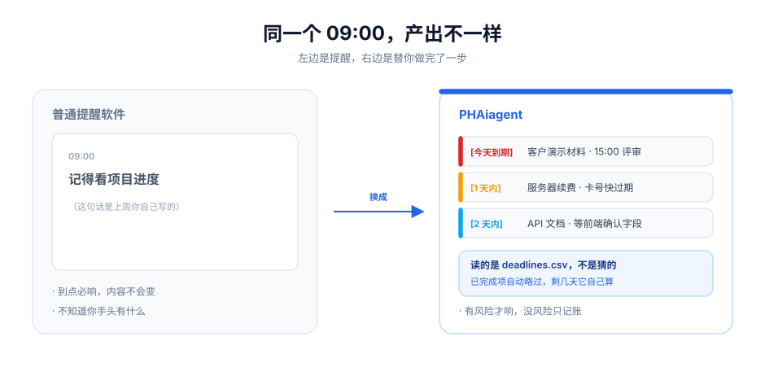
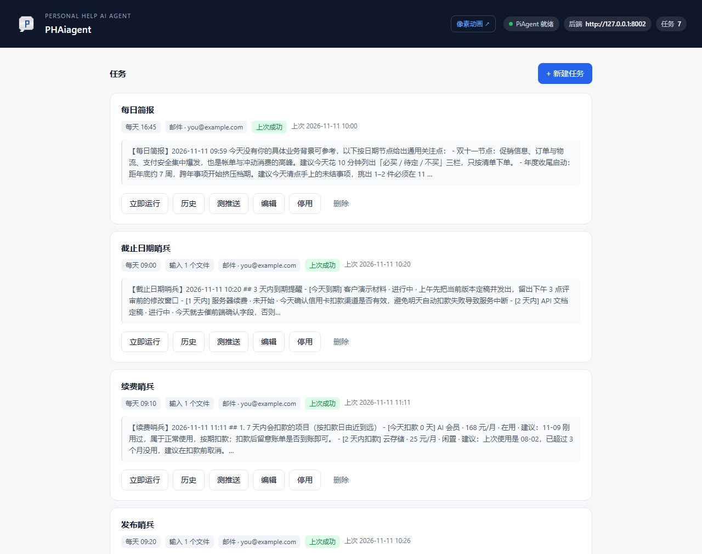
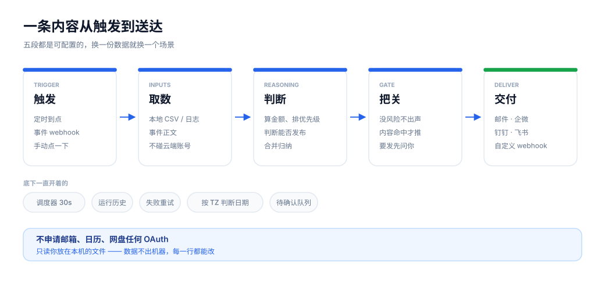
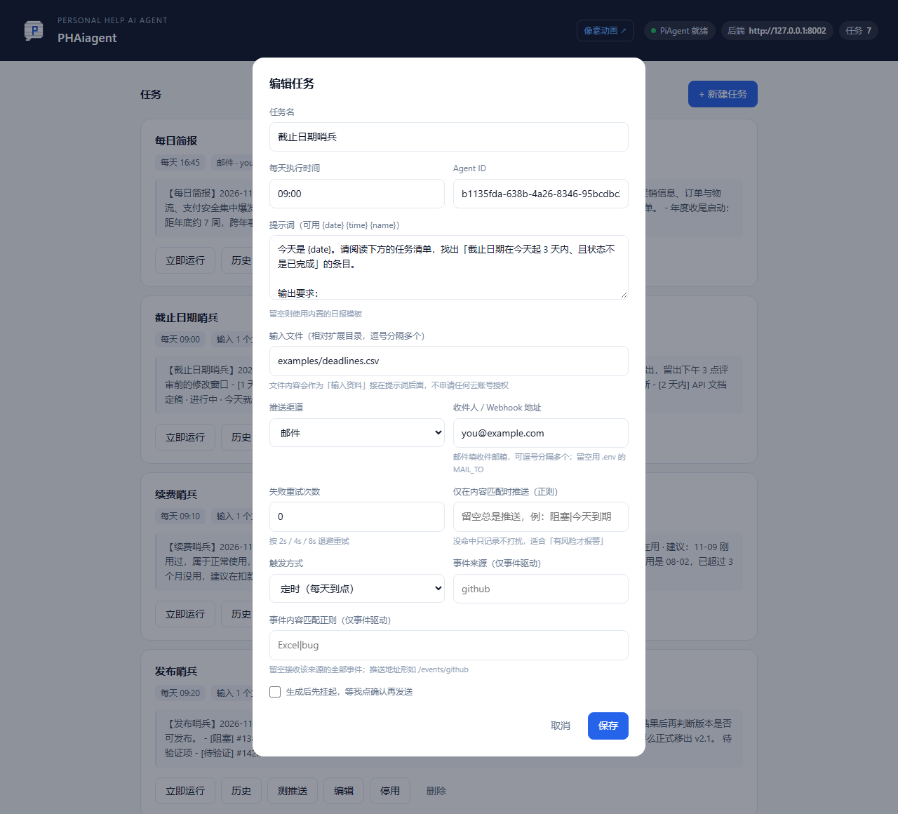

<div align="center">
  
</div>

<p align="center">
  <strong>读你的数据 · 自己判断 · 发之前先问你</strong><br>
  <sub>一个跑在本机、不用打开任何页面的个人助理智能体</sub>
</p>

<p align="center">
  
  
  
  <a href="LICENSE"></a>
  
</p>



<p align="center">
  <sub>左边是提醒，右边是替你做完了一步：读你的数据、自己算、只在该说话的时候说话</sub>
</p>

## 目录

- [为什么不是「又一个提醒工具」](#为什么不是又一个提醒工具)
- [内置场景包](#内置场景包)
- [快速开始](#快速开始)
- [工作方式](#工作方式)
- [任务模型](#任务模型)
- [事件驱动](#事件驱动)
- [审批确认](#审批确认)
- [推送渠道](#推送渠道)
- [可靠性与可观测](#可靠性与可观测)
- [接口](#接口)
- [配置](#配置)
- [部署](#部署)
- [品牌资产](#品牌资产)
- [已知限制](#已知限制)

## 为什么不是「又一个提醒工具」

| | 普通提醒 / 待办 | PHAiagent |
|:--|:--|:--|
| **内容从哪来** | 你预先写好的字，到点原样弹出 | 每次读你的文件重新算、重新写 |
| **有没有判断** | 无，规则匹配 | 算闲置订阅每月浪费多少、判断版本能不能发、把 4 项工作合并成 3 类 |
| **什么时候吵你** | 到点必响，内容不会变 | 没风险就静默；真要发出去，先问你一句 |
| **能不能被触发** | 只能等时间 | 时间 / webhook 事件 / 手动，三种都行 |
| **出错怎么办** | 静默失败 | 重试 + 记历史，成功率和耗时都能回看 |

一句话：普通工具提醒**你**去做事，PHAiagent 替你**先做了一半**。

## 关于位置

它是 AgentFlow 的一个独立扩展，不 import 主项目任何模块，只通过 HTTP 用主后端两个能力：

```
登录换 token  →  POST /api/v1/pi/{agent_id}/run  →  拿到文本 + 产物  →  投递
```

所以能单独拷走、单独部署、单独开源；删掉它不影响主项目任何功能。

> 目录名 `daily-briefing` 是它最早的功能定位，保留不动；产品名是 PHAiagent。

## 内置场景包

四个场景**共用同一套代码**，差别只有一份 CSV 和一段提示词。数据都在 `examples/`，界面点「立即运行」直接看结果。

| 场景 | 输入 | Agent 实际做什么 |
|:--|:--|:--|
| **截止日期哨兵** | `deadlines.csv` | 筛 3 天内到期且未完成的，按剩余天数排序，略过已完成项 |
| **续费哨兵** | `subscriptions.csv` | 找 7 天内扣款项，标出闲置订阅，算出每月浪费 ¥324、占月费 52% |
| **发布哨兵** | `release_issues.csv` | 判断 v2.1 能否发布，列阻塞 / 待验证 / 可延后，给放行条件 |
| **周报起草** | `weeklog.csv` | 按已完成 / 进行中 / 风险 / 下周计划成稿，推断项标「（推断）」 |

再看两个能力型的：

| 场景 | 触发 | 说明 |
|:--|:--|:--|
| **GitHub 事件助理** | 仓库 webhook | issue 一开就判断「今天必须处理 / 本周内 / 可排期」，并给负责人建议 |
| **待确认的续费提醒** | 定时 | 先生成、挂起，推一条确认链接；你点「确认发送」才真正投递 |

换一份 CSV、换一段提示词就是新场景，不用改代码。

## 快速开始

```bash
cd extensions/daily-briefing

# 1) 装依赖（只有三个）
python -m venv .venv
.venv/Scripts/pip install -r requirements.txt      # Windows
# source .venv/bin/activate && pip install -r requirements.txt   # macOS / Linux

# 2) 配置
cp .env.example .env
#   必填：AGENTFLOW_EMAIL / AGENTFLOW_PASSWORD / AGENTFLOW_AGENT_ID
#   选填：SMTP_*（发邮件）、DEFAULT_WEBHOOK_URL（默认推送地址）

# 3) 启动
python main.py
```

打开 **http://127.0.0.1:8010/ui/** 就是管理界面：



任务列表、立即运行、运行历史、推送测试都在里面，不用碰命令行。

启动前主后端要满足两条：

1. `PIAGENT_ENABLED=true`（在 `backend/.env` 里，改完重启后端）
2. 有一个可用的 Agent，把 id 填到 `AGENTFLOW_AGENT_ID`

不确定就先访问 `GET /health`，它会告诉你主后端连没连上、PiAgent 是否就绪、当前时区是什么。

## 工作方式



五段都是可配置的：换一份 CSV 换一段提示词，就是一个新场景，不用改代码。

任务、历史、待确认项都存在扩展目录 `data/` 下，不写主库。

## 任务模型

一个任务 = 触发 + 输入 + 提示词 + 投递。这些字段都能在界面上配，也可以直接调接口：



全部字段：

| 字段 | 默认 | 说明 |
|:--|:--|:--|
| `name` | 必填 | 任务名，也是邮件标题 |
| `trigger` | `cron` | `cron` 定时 / `event` 事件驱动 |
| `schedule` | 必填 | `HH:MM`，每天执行；事件任务忽略 |
| `inputs` | `[]` | 本地输入文件（相对扩展目录），内容注入提示词 |
| `prompt` | 内置模板 | 支持 `{date}` `{time}` `{name}` |
| `skills` | `[]` | 指定加载的技能名 |
| `webhook_kind` | `generic` | `email` / `wecom` / `dingtalk` / `feishu` / `generic` |
| `webhook_url` | `""` | 收件邮箱或 webhook 地址 |
| `timeout` | `180` | 单次执行超时，30–900 秒 |
| `retry` | `0` | 失败重试次数 0–5，退避 2s / 4s / 8s |
| `push_if` | `""` | 正则，内容命中才推送；留空总是推 |
| `require_approval` | `false` | 生成后挂起，等人确认再发 |
| `catch_up` | `true` | 服务晚启动/重启会补跑当天这一班 |
| `event_source` | `""` | 仅事件任务：限定来源，如 `github` |
| `event_filter` | `""` | 仅事件任务：事件正文正则，命中才触发 |
| `enabled` | `true` | 停用的任务不会被调度和事件触发 |

## 事件驱动

```
POST /events/{source}        ← GitHub webhook、自建服务回调、脚本都能推
     ↓
trigger=event 且 event_source 匹配 且 event_filter 命中
     ↓
立刻执行（事件正文作为输入资料注入提示词）
```

接 GitHub：仓库 Settings → Webhooks → Add webhook，Payload URL 填
`https://你的域名/events/github`，Content type 选 `application/json`。
设了 `WEBHOOK_SECRET` 会用 `X-Hub-Signature-256` 做 HMAC 校验，签名不符直接 401。

不接真仓库也能自测：

```bash
curl -X POST http://127.0.0.1:8010/events/github \
  -H "Content-Type: application/json" \
  -d '{"action":"opened","issue":{"number":151,"title":"导出 Excel 时中文乱码","labels":[{"name":"bug"}]}}'
```

返回 `{"source":"github","matched":["GitHub 事件助理"],"results":[...]}`。

## 审批确认

任务勾上 `require_approval` 后：

```
Agent 生成内容 → 挂起 → 推送「待确认」通知（含一次性链接）
                          ↓ 点「确认发送」
                    内容才真正投递；点「丢弃」就作废
```

- 链接形如 `/approvals/{id}?token=...`，token 由 `secrets.token_urlsafe` 生成，对不上直接 403
- 记录留在 `data/approvals.json`，`GET /approvals?status=pending` 查待办
- 部署到公网要把 `PUBLIC_BASE_URL` 改成真实域名，否则链接指向 127.0.0.1

## 推送渠道

| 渠道 | `webhook_kind` | 说明 |
|:--|:--|:--|
| 邮件 | `email` | `webhook_url` 填收件人（逗号分隔多个），留空用 `MAIL_TO` |
| 企业微信 | `wecom` | 群设置 → 群机器人 → 复制 Webhook |
| 钉钉 | `dingtalk` | 群设置 → 智能群助手 → 自定义机器人 → 复制 Webhook |
| 飞书 | `feishu` | 群设置 → 群机器人 → 自定义机器人 → 复制 Webhook |
| 通用 | `generic` | 直接 `POST {"text": "..."}`；Slack Incoming Webhook 也是这个格式 |

**邮件**用标准库 `smtplib`，零额外依赖。SMTP 配置填 `SMTP_*`；什么都不填时会回退读主项目同名的 `MAIL_*`，已配好发信的部署可直接用。

邮件是 HTML + 纯文本双版本：支持 HTML 的客户端看到带标题层级、表格和列表排版的版本，不支持时退化成一封可读的纯文本。主题是 `【任务名】YYYY-MM-DD`。

QQ 邮箱、163 要用「授权码」而不是登录密码；465 端口配 `SMTP_USE_SSL=true`，587 端口配 `false`（走 STARTTLS）。

钉钉如果开了「加签」，本扩展不做签名计算，需要自己在 webhook 地址里带上 `timestamp` 与 `sign`。

## 可靠性与可观测

| 能力 | 说明 |
|:--|:--|
| 失败重试 | `retry` 次数，指数退避 2s / 4s / 8s，每次尝试都计入历史 |
| 条件推送 | `push_if` 没命中就只记录不推送，平时不打扰 |
| 运行历史 | `data/runs.jsonl` 保留最近 1000 条；界面「历史」可看时间、耗时、尝试次数、推送状态、摘要与错误 |
| 成功率 | `/runs` 返回 `total / ok / failed / success_rate` |
| 时区 | `TZ`（默认 `Asia/Shanghai`），调度按它判断「几点」「今天跑过没有」 |

推送失败不影响任务判定：内容已生成就算成功，失败原因记在 `last_error` 和历史的 `error` 里，调度器继续跑下一个。

## 接口

| 方法 | 路径 | 说明 |
|:--|:--|:--|
| GET | `/health` | 状态 + 主后端连通性 + PiAgent + 时区 |
| GET | `/tasks` | 任务列表 |
| POST | `/tasks` | 新建任务 |
| PATCH | `/tasks/{id}` | 改任意字段 |
| DELETE | `/tasks/{id}` | 删除 |
| POST | `/tasks/{id}/run?push=true` | 立即跑一次 |
| POST | `/tasks/{id}/test-webhook` | 只测推送通道，不跑 Agent |
| GET | `/runs?task_id=&limit=` | 运行历史 + 成功率 |
| POST | `/events/{source}` | 接收事件，匹配到任务后执行 |
| GET | `/approvals?status=pending` | 待确认列表 |
| GET | `/approvals/{id}?token=` | 确认页（HTML） |
| POST | `/approvals/{id}/approve` | 确认发送 |
| POST | `/approvals/{id}/reject` | 丢弃 |
| GET | `/ui/` | 管理界面 |
| GET | `/docs` | 自动生成的接口文档 |

## 配置

全部走环境变量，也支持同目录 `.env`（`.env` 已在 `.gitignore` 里）。

| 变量 | 默认 | 说明 |
|:--|:--|:--|
| `AGENTFLOW_BASE_URL` | `http://127.0.0.1:8001` | 主后端地址（精简版通常是 8002） |
| `AGENTFLOW_EMAIL` / `AGENTFLOW_PASSWORD` | 空 | 服务账号，建议单独建一个 |
| `AGENTFLOW_AGENT_ID` | 空 | 默认 Agent |
| `DEFAULT_WEBHOOK_URL` / `DEFAULT_WEBHOOK_KIND` | 空 / `generic` | 新建任务时的默认推送 |
| `SMTP_HOST` 等 | 回退 `MAIL_*` | 邮件通道 |
| `MAIL_TO` | 空 | 任务未指定收件人时的兜底 |
| `PUBLIC_BASE_URL` | `http://127.0.0.1:8010` | 审批链接用它拼，公网部署必改 |
| `WEBHOOK_SECRET` | 空 | 事件验签密钥，留空则不校验 |
| `TZ` | `Asia/Shanghai` | 调度时区 |
| `HOST` / `PORT` | `127.0.0.1` / `8010` | 监听地址与端口 |
| `TICK_SECONDS` | 30 | 调度检查间隔 |
| `DATA_DIR` | `data` | 任务 / 历史 / 审批的存放目录 |

## 部署

systemd：

```ini
[Unit]
Description=PHAiagent
After=network.target

[Service]
WorkingDirectory=/opt/agentflow/extensions/daily-briefing
ExecStart=/opt/agentflow/extensions/daily-briefing/.venv/bin/python main.py
Restart=always
RestartSec=5

[Install]
WantedBy=multi-user.target
```

Docker：

```dockerfile
FROM python:3.12-slim
WORKDIR /app
COPY requirements.txt .
RUN pip install --no-cache-dir -r requirements.txt
COPY . .
CMD ["python", "main.py"]
```

## 品牌资产

- **网页版动画**：`/ui/morph.html`，canvas 实时粒子变形（像素 logo ⇄ `PHAiagent`），可暂停、可看静态帧
- **邮件版动画**：GIF 以 `cid` 内联，不依赖外链；只显示首帧的客户端（Outlook 桌面版）看到的是完整 logo，禁用图片时显示 `alt` 文字
- 重新生成：改 `tools/make_morph_gif.py` 顶部的 `HOLD_MS`（停留时长）、`MORPH_MS`（变形时长）、`FRAME_MS`（帧间隔）后运行 `python tools/make_morph_gif.py`，会自动同步三处素材

本 README 里的三张图（`banner.svg` / `flow.svg` / `compare.svg`）由
`tools/make_readme_figures.py` 生成，改文案或配色重跑即可，不用手调坐标。
`tools/preview_readme.py` 能把 README 渲染成 GitHub 风格的 HTML，本地改完先看排版。

## 已知限制

- **判断质量取决于提示词**。它不会凭空知道你的业务；给的信息越结构化（列头清晰的 CSV），产出越靠谱。
- **单机单进程**。任务、历史、待确认项都在 JSON 文件里，多实例同跑会重复执行。
- **只交付文本**，还不能生成 Excel / Markdown 文件给你下载。
- **钉钉加签、企微图片消息**未实现，目前只推纯文本。
- `event_filter` / `push_if` 是正则，写错时行为分别是「不触发」和「按命中处理」，前者需要留意日志。

## License

[Apache-2.0](LICENSE) —— 与 AgentFlow 主仓库保持一致。

允许包括商业用途在内的使用、修改与再分发；除许可证条款外不附加任何用途限制。
